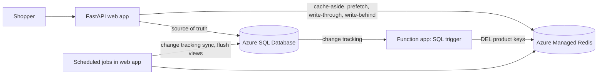

# Retail cache sample: Caching patterns for Azure SQL Database

A small retail storefront that demonstrates five caching patterns with **Azure SQL
Database** as the source of truth and **Azure Managed Redis** as the cache. Both
authenticate with **Microsoft Entra ID** (managed identity), so there are no keys or
passwords in the deployed app.

This sample is the runnable companion to the Microsoft Learn article
*Improve performance by using a cache with Azure SQL Database*. Each pattern module
matches a step in that article.

> Part of [amr-caching-pattern-samples](../README.md). Run the commands in this README
> from the `azure-sql-retail-sample/` folder.

## Patterns

How the caching patterns (see the [repository README](../README.md#caching-patterns)
for what each one is) map to this storefront:

| Pattern | Storefront feature | Azure SQL + Redis mechanism |
| --- | --- | --- |
| Cache-aside | Product detail pages | `GET`/`SET` with TTL, plus short-lived "not found" entries |
| Reference-data prefetching | Category chips | Redis hash loaded at startup, kept current with SQL change tracking |
| Write-through | Price updates | Update Azure SQL, then update the cached product |
| Event-driven invalidation | Restock from the warehouse | Azure Functions SQL trigger deletes changed product keys |
| Write-behind | Product view counts | `HINCRBY` in Redis, batched `MERGE` into Azure SQL |

## Architecture



## See the patterns in action

Open the running app (the URL `azd` prints as `SERVICE_WEB_URI`, or
`http://localhost:8000` when [running locally](#run-locally)). Each pattern maps to
something you can do in the storefront.

- **Cache-aside: product pages.** Open any product (`/product/<id>`). The first
  request is a miss, so the app reads Azure SQL and writes Redis with a TTL (key
  `product:<id>`); reloads show **Served from Redis cache** and the read time. A
  product that doesn't exist is cached briefly as "not found" so repeated misses
  don't reach the database. See [`cache_aside.py`](src/app/patterns/cache_aside.py).
- **Reference-data prefetching: category chips.** Categories are loaded into the
  Redis hash `ref:categories` at startup, so the catalog page never queries them. On
  the home page, expand **Rename a category (change tracking sync)** and save. The
  rename goes only to Azure SQL; a scheduled job reads `CHANGETABLE(CHANGES ...)`
  since the last synced version and updates just the changed entries within
  `SYNC_INTERVAL_SECONDS`. See [`prefetch.py`](src/app/patterns/prefetch.py).
- **Write-through: price updates.** On a product page, expand **Update price
  (write-through)** and save. The app writes Azure SQL, then refreshes the cached
  product, so the new price shows immediately. The SQL trigger also sees this change
  and deletes the key a few seconds later; the next read reloads it from the
  database. See [`write_through.py`](src/app/patterns/write_through.py).
- **Event-driven invalidation: restock.** On a product page, expand **Restock from
  the warehouse** and click **Restock**. This updates Azure SQL directly and doesn't
  touch Redis, the way a batch job or another service would. The Azure Functions
  SQL trigger sees the change through change tracking and deletes
  `product:<id>`, so the next read loads the new stock. See
  [`invalidation.py`](src/app/patterns/invalidation.py) and
  [`functions/function_app.py`](functions/function_app.py).
- **Write-behind: view counts.** Every product page view increments a counter in
  the Redis hash `{views}:pending`. A scheduled job renames it to
  `{views}:flushing` and writes the batch to `dbo.ProductStats` with one `MERGE`
  every `FLUSH_INTERVAL_SECONDS`. Open `/stats` to see flushed and pending counts.
  See [`write_behind.py`](src/app/patterns/write_behind.py).

## Deploy to Azure

Prerequisites:
- [azd](https://aka.ms/azd-install)
- [Azure CLI](https://learn.microsoft.com/cli/azure/install-azure-cli)
- An Azure subscription
- Permissions to create resources **and role assignments**: **Owner**, or
  **Contributor + Role Based Access Control Administrator** (the template assigns
  roles to the app and function identities, which Contributor alone can't do)
- Python 3.10 or later (only needed to run locally)

```bash
azd auth login
azd up
```

On first start the web app creates the schema, enables change tracking, grants the
function app's identity what the SQL trigger needs, and seeds the catalog, so the
storefront is ready as soon as `azd` finishes. Until that first start finishes, the
function app's log shows SQL trigger listener errors such as `Login failed`, because
its database user doesn't exist yet. The host retries, and the listener starts on its
own once the grants are in place.

> TIP: If `azd up` fails on a resource, try redeploying in a different region:
> `azd down --purge --force`, then `azd env set AZURE_LOCATION <region>` and `azd up`.

### What gets provisioned

**This bills while it runs**, so tear it down when you are done.

| Resource | SKU / tier |
| --- | --- |
| Azure Managed Redis | `Balanced_B0`, OSS clustering policy, Entra-only auth |
| Azure SQL Database | `Basic`, Entra-only auth |
| Azure Container Apps environment + web app | Consumption, 1-3 replicas |
| Azure Functions app (SQL trigger) | Linux App Service plan `B1`, Python 3.12 |
| Storage account (Functions runtime) | `Standard_LRS` |
| Azure Container Registry | `Basic` |
| User-assigned managed identities (web app, function app) | - |

Prices:
[Azure Managed Redis](https://azure.microsoft.com/pricing/details/managed-redis/),
[Azure SQL Database](https://azure.microsoft.com/pricing/details/azure-sql-database/single/),
[Azure Container Apps](https://azure.microsoft.com/pricing/details/container-apps/),
[Azure Functions](https://azure.microsoft.com/pricing/details/functions/)

### Tear it down

```bash
azd down --purge --force
```

`--purge` also purges any soft-deleted resources (several Azure services keep a
recoverable copy after delete) so nothing lingers or keeps billing.

## Run locally

Run the app on your machine against the Azure resources you deployed. The app
authenticates as your `az login` account. During `azd up`, the template already
gave your account Redis access and the seed step created a least-privilege database
user for you (`db_datareader`, `db_datawriter`, and `VIEW CHANGE TRACKING`), so you
only need to open the SQL firewall for your IP.

Get `<resource-group>`, `<server-name>`, `<amr-name>`, and `<region>` from
`azd env get-values`.

```powershell
$ip = Invoke-RestMethod https://api.ipify.org
az sql server firewall-rule create `
  --resource-group <resource-group> `
  --server <server-name> `
  --name AllowMyDevIP --start-ip-address $ip --end-ip-address $ip
```

Then run the app:

```powershell
python -m venv .venv; .venv\Scripts\Activate.ps1
pip install -r requirements.txt
$env:SQL_SERVER = "<server-name>.database.windows.net"
$env:SQL_DATABASE = "retail"
$env:REDIS_HOST = "<amr-name>.<region>.redis.azure.net"
$env:REDIS_PORT = "10000"
$env:REDIS_USER_OBJECT_ID = (az ad signed-in-user show --query id -o tsv)
$env:RUN_JOBS = "false"
$env:AUTO_SEED = "false"
uvicorn app.main:app --app-dir src --reload --reload-dir src
```

`RUN_JOBS=false` and `AUTO_SEED=false` are recommended locally because the deployed
app already seeded the shared database and runs the scheduled jobs. The SQL trigger
runs in the deployed function app, so restocks from your local app are still
invalidated.

Open http://localhost:8000 and try the patterns above. (You can also copy
`.env.example` to `.env` and fill in the same values instead of setting environment
variables.)

## Least-privilege in production

For simplicity this sample makes the web app's identity the Azure SQL **Microsoft
Entra admin**, so it can create the schema, enable change tracking, and grant the
function identity on first start. In production, don't use an admin for regular
database operations. Use an admin only for setup, then give the app identity only
the grants it needs, as the function identity and developer user in
[`seed.py`](src/app/seed.py) already show.
[See more information.](https://learn.microsoft.com/azure/azure-sql/database/authentication-aad-overview)

## Layout

```
src/app/
  main.py            FastAPI app + storefront routes (each tagged with its pattern)
  jobs.py            Scheduled change-tracking sync and write-behind flush (Redis lock per job)
  config.py          Environment settings
  db.py              mssql-python connection with Entra auth (ActiveDirectoryDefault)
  cache.py           redis-py RedisCluster client with Entra auth
  seed.py            Schema, change tracking, grants, and sample catalog
  schema.sql         Tables and change tracking setup
  patterns/          The caching patterns (the teaching core)
  templates/, static/  Self-contained storefront UI
functions/
  function_app.py    Azure SQL trigger that invalidates product keys
  shared/cache.py    Same Redis client as the web app
infra/               Bicep (Container Apps, Azure SQL, Azure Managed Redis, Functions)
```

## Notes

- **Drivers:** the app uses [mssql-python](https://github.com/microsoft/mssql-python),
  the Microsoft Python driver for SQL Server and Azure SQL. It doesn't need a
  separate ODBC driver; the Dockerfile installs only the native libraries it needs on
  Linux.
- **Clustering:** Azure Managed Redis uses the **OSS clustering policy** and the app
  connects with a cluster-aware client (`redis.cluster.RedisCluster`), which routes
  each key to its shard. Because OSS cluster clients connect to shard nodes by IP,
  the client disables TLS hostname verification; the CA certificate chain is still
  validated. Write-behind keys share the `{views}` hash tag so `RENAME` stays on one
  shard.
- **Redis authentication:** to match its companion article, this sample uses a minimal
  custom `CredentialProvider` that fetches a Microsoft Entra token whenever a
  connection opens, with the identity's object ID (`REDIS_USER_OBJECT_ID`) as the Redis
  username. For long-running production apps, use
  [redis-entraid](https://github.com/redis/redis-py-entraid), which refreshes tokens
  automatically, as the Azure Cosmos DB sample does.
- **Scheduled jobs:** the change-tracking sync and write-behind flush run on threads
  inside the web app (`RUN_JOBS=true`) to keep the sample to one deployable app. A
  short Redis lock makes sure only one replica runs each job per interval. In
  production, run them from a single scheduled job, such as a timer-triggered
  function.
- **UI assets:** the catalog data and product images come from the MIT-licensed
  [dotnet/eShop](https://github.com/dotnet/eShop) sample, bundled under
  `src/app/static/img/`. Swap them by editing `PRODUCTS` in `seed.py`.

## License

This sample is part of [amr-caching-pattern-samples](../README.md) and is licensed under
the [MIT License](../LICENSE). It bundles catalog data and product images from the
MIT-licensed [dotnet/eShop](https://github.com/dotnet/eShop); see
[ThirdPartyNotices.txt](ThirdPartyNotices.txt) for attribution.
