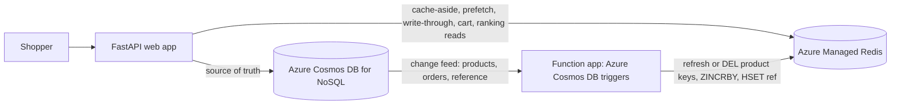

# Retail cache sample: Caching patterns for Azure Cosmos DB for NoSQL

A small retail storefront that demonstrates six caching patterns with **Azure Cosmos
DB for NoSQL** as the source of truth and **Azure Managed Redis** as the cache. Both
authenticate with **Microsoft Entra ID** (managed identity), so there are no keys or
passwords in the deployed app.

This sample is the runnable companion to the Microsoft Learn article
*Optimize costs by using a cache with Azure Cosmos DB for NoSQL*. Each pattern module
matches a step in that article.

> Part of [amr-caching-pattern-samples](../README.md). Run the commands in this README
> from the `cosmos-db-retail-sample/` folder.

## Patterns

How the caching patterns (see the [repository README](../README.md#caching-patterns)
for what each one is) map to this storefront:

| Pattern | Storefront feature | Azure Cosmos DB + Redis mechanism |
| --- | --- | --- |
| Cache-aside | Category listings and product pages | Single-partition query or point read on a miss, `SET` with a jittered TTL, short-lived "not found" entries, soft-deleted items filtered out |
| Reference-data prefetching | Category chips, shipping options, store settings | `reference` container loaded into Redis hashes at startup, kept current from the change feed |
| Write-through | Price updates | Patch the item in Azure Cosmos DB, then cache the item the patch returns |
| Event-driven refresh | Restock or remove from another system | Azure Functions trigger for Azure Cosmos DB refreshes cached products with `SET XX KEEPTTL`, deletes soft-deleted ones, and deletes listings |
| Sorted-set ranking | Best sellers | Azure Functions trigger on `orders` adds quantities with `ZINCRBY`; the page reads one `ZREVRANGE` |
| Session and state offload | Shopping cart | Redis hash with a sliding TTL; checkout writes one order with an idempotency key |

## Architecture



## See the patterns in action

Open the running app (the URL `azd` prints as `SERVICE_WEB_URI`, or
`http://localhost:8000` when [running locally](#run-locally)). Each pattern maps to
something you can do in the storefront.

- **Cache-aside: listings and product pages.** The catalog shows each category's
  top-rated products. The first request for a category is a miss, so the app runs a
  single-partition query and caches the result (key `category:<categoryId>:top`); a
  reload shows **Listing served from Redis cache**. Open any product
  (`/product/<categoryId>/<id>`): the first request point-reads the item and caches it
  (key `product:<categoryId>:<id>`), and reloads show **Served from Redis cache**. A
  product that doesn't exist, or was soft-deleted, is cached briefly as "not found" so
  repeated requests don't cost RUs. See [`cache_aside.py`](src/app/patterns/cache_aside.py).
- **Reference-data prefetching: category chips.** Categories, shipping options, and
  store settings are loaded from the `reference` container into the Redis hashes
  `ref:category`, `ref:shipping`, and `ref:config` at startup, with no TTL. On the
  home page, expand **Rename a category** and save. The rename goes only to Azure
  Cosmos DB; the `refresh_reference` function reads it from the change feed and
  writes it with `HSET`, so the chip changes within seconds. See
  [`prefetch.py`](src/app/patterns/prefetch.py) and
  [`functions/function_app.py`](functions/function_app.py).
- **Write-through: price updates.** On a product page, expand **Update price
  (write-through)** and save. The app patches the price in Azure Cosmos DB, caches the
  item that the patch returns, and deletes the category listing, so the new price
  shows immediately and the page is still served from Redis. See
  [`write_through.py`](src/app/patterns/write_through.py).
- **Event-driven refresh: restock and remove.** On a product page, expand **Restock
  from the warehouse** and click **Restock**. This patches Azure Cosmos DB directly and
  doesn't touch Redis, the way an import or another service would. The
  `refresh_products` function reads the change feed and refreshes the cached product
  with `SET ... XX KEEPTTL`, so a reload a few seconds later shows the new stock, still
  from the cache. **Remove this product** sets `isDeleted` and a `ttl` (a soft
  delete); the function deletes the cached product and listing, so the product
  disappears from the catalog. See
  [`external_writes.py`](src/app/patterns/external_writes.py) and
  [`functions/function_app.py`](functions/function_app.py).
- **Sorted-set ranking: best sellers.** Check out a cart (below), then open **Best
  sellers**. The `update_bestsellers` function reads the change feed on `orders` and
  adds each line's quantity to the sorted set `bestsellers` with `ZINCRBY`, counting
  each order once. The page reads the top 10 with one `ZREVRANGE`. See
  [`ranking.py`](src/app/patterns/ranking.py).
- **Session and state offload: the cart.** **Add to cart** updates the Redis hash
  `cart:<user>` and resets its 30-minute TTL; it costs no RUs. **Check out** reads
  current prices from Azure Cosmos DB and writes one order whose ID is the checkout ID,
  then deletes the cart. Submitting the same checkout twice returns the existing order
  instead of creating a second one. See [`cart.py`](src/app/patterns/cart.py).

## Deploy to Azure

Prerequisites:
- [azd](https://aka.ms/azd-install)
- [Azure CLI](https://learn.microsoft.com/cli/azure/install-azure-cli)
- An Azure subscription
- Permissions to create resources **and role assignments**: **Owner**, or
  **Contributor + Role Based Access Control Administrator** (the template assigns
  roles to the app and function identities, which Contributor alone can't do)
- Python 3.11+ (only needed to run locally)

```bash
azd auth login
azd up
```

The template creates the `retail` database and its containers (`products`, `orders`,
`reference`, and `leases`), because a data-plane role can't create them. On first
start the web app seeds the catalog and reference data and loads the reference
hashes, so the storefront is ready as soon as `azd` finishes.

> TIP: If `azd up` fails on a resource, try redeploying in a different region:
> `azd down --purge --force`, then `azd env set AZURE_LOCATION <region>` and `azd up`.

### What gets provisioned

**This bills while it runs**, so tear it down when you are done.

| Resource | SKU / tier |
| --- | --- |
| Azure Managed Redis | `Balanced_B0`, OSS clustering policy, Entra-only auth |
| Azure Cosmos DB for NoSQL account | Serverless, local (key) auth disabled |
| Azure Container Apps environment + web app | Consumption, 1-3 replicas |
| Azure Functions app (Azure Cosmos DB triggers) | Linux App Service plan `B1`, Python 3.11 |
| Storage account (Functions runtime) | `Standard_LRS` |
| Azure Container Registry | `Basic` |
| User-assigned managed identities (web app, function app) | - |

Prices:
[Azure Managed Redis](https://azure.microsoft.com/pricing/details/managed-redis/),
[Azure Cosmos DB](https://azure.microsoft.com/pricing/details/cosmos-db/serverless/),
[Azure Container Apps](https://azure.microsoft.com/pricing/details/container-apps/),
[Azure Functions](https://azure.microsoft.com/pricing/details/functions/)

### Tear it down

```bash
azd down --purge --force
```

`--purge` also purges any soft-deleted resources (several Azure services keep a
recoverable copy after delete) so nothing lingers or keeps billing.

## Run locally

Run the app on your machine against the Azure resources you deployed. The app
authenticates as your `az login` account. During `azd up`, the template already gave
your account the **Cosmos DB Built-in Data Contributor** role and a Redis access
policy assignment, and the account accepts connections from any network, so there's
nothing else to set up.

Get `<cosmos-account>`, `<amr-name>`, and `<region>` from `azd env get-values`
(`COSMOS_ENDPOINT` and `REDIS_HOST` hold the full values).

```powershell
python -m venv .venv; .venv\Scripts\Activate.ps1
pip install -r requirements.txt
$env:COSMOS_ENDPOINT = "https://<cosmos-account>.documents.azure.com:443/"
$env:COSMOS_DATABASE = "retail"
$env:REDIS_HOST = "<amr-name>.<region>.redis.azure.net"
$env:REDIS_PORT = "10000"
$env:AUTO_SEED = "false"
uvicorn app.main:app --app-dir src --reload --reload-dir src
```

`AUTO_SEED=false` is recommended locally because the deployed app already seeded the
shared account. The Azure Cosmos DB triggers run in the deployed function app, so
renames, restocks, and orders from your local app still update the cache.

Open http://localhost:8000 and try the patterns above. (You can also copy
`.env.example` to `.env` and fill in the same values instead of setting environment
variables.)

## Least-privilege in production

The web app, the function app, and your developer account get only the **Cosmos DB
Built-in Data Contributor** role, which reads and writes items but can't create or
change databases, containers, or settings. That's why the template, not the app,
creates the database and containers, including the `leases` container that the
Azure Functions trigger would otherwise try to create. In production, consider a
[custom role definition](https://learn.microsoft.com/azure/cosmos-db/how-to-connect-role-based-access-control)
scoped to the containers each identity uses, for example read-only access to
`reference` for the web app.
[See more information.](https://learn.microsoft.com/azure/cosmos-db/how-to-connect-role-based-access-control)

## Layout

```
src/app/
  main.py            FastAPI app + storefront routes (each tagged with its pattern)
  config.py          Environment settings
  db.py              azure-cosmos client with Entra auth (DefaultAzureCredential)
  cache.py           redis-py RedisCluster client with redis-entraid, created on first use
  seed.py            Sample catalog and reference data (upserts missing items only)
  patterns/          The caching patterns (the teaching core)
  templates/, static/  Self-contained storefront UI
functions/
  function_app.py    Azure Cosmos DB triggers: refresh products, best sellers, reference data
  shared/cache.py    The article's step 2 clients and clean()
infra/               Bicep (Container Apps, Azure Cosmos DB, Azure Managed Redis, Functions)
```

## Notes

- **Clustering:** Azure Managed Redis uses the **OSS clustering policy** and the app
  connects with a cluster-aware client (`redis.cluster.RedisCluster`), which routes
  each key to its shard. Because OSS cluster clients connect to shard nodes by IP,
  the client disables TLS hostname verification; the CA certificate chain is still
  validated. Each multi-key pipeline in the sample touches keys the cluster client
  can route individually, so no hash tags are needed.
- **Why the Redis client is created lazily:** the redis-entraid credential provider
  requests its first token on the thread that opens the first connection. If an
  asyncio event loop is running on that thread, it blocks the loop while waiting for
  a token that the loop itself must fetch, so the process hangs. Uvicorn imports the
  app inside its event loop, so [`cache.py`](src/app/cache.py) creates the client on
  first use, on a separate thread. For the same reason, each function in
  [`function_app.py`](functions/function_app.py) imports `shared.cache` inside its
  body, as the article does.
- **Change feed and deletes:** the triggers read the change feed in latest version
  mode, which doesn't include deletes or TTL expirations. Removing a product is a soft
  delete: set `isDeleted` and a `ttl`, and Azure Cosmos DB removes the item after the
  TTL (`SOFT_DELETE_TTL_SECONDS`, one hour by default). Seeding re-creates missing
  sample products on the next start.
- **Change feed latency:** after the trigger processes all current changes, it waits
  5 seconds by default (`feed_poll_delay`) before it polls again, so cache updates
  from other writers typically land within a few seconds.
- **No sign-in:** each browser gets an anonymous ID in a cookie, which the sample uses
  as both the cart owner and the order's `customerId` partition key value.
- **UI assets:** the catalog data and product images come from the MIT-licensed
  [dotnet/eShop](https://github.com/dotnet/eShop) sample, bundled under
  `src/app/static/img/`. Swap them by editing `PRODUCTS` in `seed.py`.

## License

This sample is part of [amr-caching-pattern-samples](../README.md) and is licensed under
the [MIT License](../LICENSE). It bundles catalog data and product images from the
MIT-licensed [dotnet/eShop](https://github.com/dotnet/eShop); see
[ThirdPartyNotices.txt](ThirdPartyNotices.txt) for attribution.
