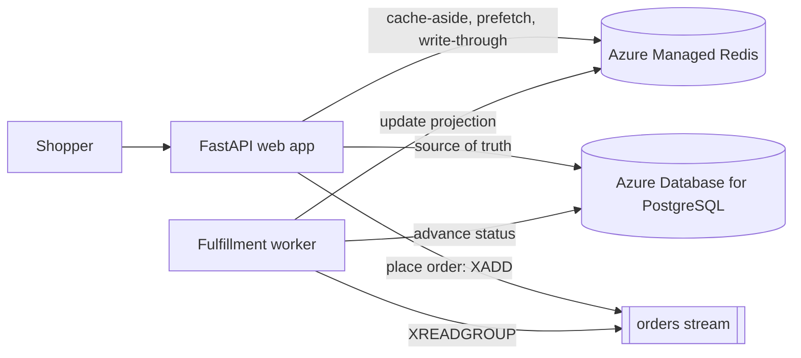

# Retail cache sample: Caching patterns for Azure Database for PostgreSQL

A small retail storefront that demonstrates four caching patterns with **Azure
Database for PostgreSQL flexible server** as the source of truth and **Azure
Managed Redis** as the cache. Both authenticate with **Microsoft Entra ID**
(managed identity), so there are no keys or passwords in the deployed app.

> Part of [amr-caching-pattern-samples](../README.md). Run the commands in this README
> from the `postgres-retail-sample/` folder.

## Patterns

How the four caching patterns (see the [repository README](../README.md#caching-patterns)
for what each one is) map to this storefront:

| Pattern | Storefront feature | Redis mechanism |
| --- | --- | --- |
| Cache-aside | Product catalog and detail pages | `GET`/`SET` with TTL |
| Reference-data prefetching | Categories and brands | Preloaded keys, refreshed on change |
| Write-through | Price and inventory updates | Update DB + cache together |
| Event-driven | Order status through fulfillment | Streams + consumer groups |

## Architecture



## See the patterns in action

Open the running app (the URL `azd` prints as `SERVICE_WEB_URI`, or
`http://localhost:8000` when [running locally](#run-locally)). Each pattern maps to
something you can do in the storefront.

- **Cache-aside - product pages.** Open any product (`/product/<id>`). The first
  request is a miss, so the app reads PostgreSQL and writes Redis with a TTL (key
  `product:<id>`); reloads are served from the cache. See [`cache_aside.py`](src/app/patterns/cache_aside.py).
- **Reference-data prefetching - category and brand chips.** Stable reference data
  is loaded into Redis up front at startup (keys `ref:categories`, `ref:brands`) and
  served without a per-request query; re-run the prefetch to refresh it when the
  source changes. See [`prefetch.py`](src/app/patterns/prefetch.py).
- **Write-through - price updates.** On a product page, expand **Update price** and
  save. The app writes PostgreSQL and refreshes Redis in the same operation, so the
  new price shows immediately with no stale window. See [`write_through.py`](src/app/patterns/write_through.py).
- **Event-driven - order fulfillment (Redis Streams).** Place an order, then watch
  the order page. The order is written to PostgreSQL and an event is appended to the
  stream `orders:events`. A consumer-group worker advances it `paid -> packed ->
  shipped -> delivered`, updating the cached status (`order:<id>:status`) as it goes;
  the page polls and updates live. See [`events.py`](src/app/patterns/events.py) + [`worker.py`](src/app/worker.py).

## Deploy to Azure

Prerequisites:
- [azd](https://aka.ms/azd-install)
- [Azure CLI](https://learn.microsoft.com/cli/azure/install-azure-cli)
- An Azure subscription
- Permissions to create resources **and role assignments** - **Owner**, or **Contributor + Role Based Access Control Administrator** (the template assigns the app's identity the AcrPull role, which Contributor alone can't do)
- Python 3.11+ (only needed to run locally)

```bash
azd auth login
azd up
```

On first start the app creates the schema and seeds the catalog automatically, so
the storefront is ready as soon as `azd` finishes.

> TIP: If `azd up` fails on a resource, try redeploying in a different region:
> `azd down --purge --force`, then `azd env set AZURE_LOCATION <region>` and `azd up`.

### What gets provisioned

**This bills while it runs**, so tear it down when you are done. 

| Resource | SKU / tier |
| --- | --- |
| Azure Managed Redis | `Balanced_B0`, OSS clustering policy |
| Azure Database for PostgreSQL flexible server | `Standard_B1ms` Burstable, 32 GB |
| Azure Container Apps environment + app | Consumption, 1-3 replicas |
| Azure Container Registry | `Basic` |
| User-assigned managed identity | - |


Prices:
[Azure Managed Redis](https://azure.microsoft.com/pricing/details/managed-redis/),
[Azure Database for PostgreSQL](https://azure.microsoft.com/pricing/details/postgresql/flexible-server/),
[Azure Container Apps](https://azure.microsoft.com/en-us/pricing/details/container-apps/)

### Tear it down

```bash
azd down --purge --force
```

`--purge` also purges any soft-deleted resources (several Azure services keep a recoverable copy after delete) so nothing lingers or
keeps billing.

## Run locally

Run the app on your machine against the Azure resources you deployed. 
The app authenticates as your Entra sign-in, so grant your account access to both once.

Get `<resource-group>`, `<server-name>`, `<amr-name>`, and `<region>` from
`azd env get-values`.

Grant yourself PostgreSQL access (Entra admin) and open the firewall for your local IP:

```powershell
az postgres flexible-server ad-admin create `
  --resource-group <resource-group> `
  --server-name <server-name> `
  --display-name (az ad signed-in-user show --query userPrincipalName -o tsv) `
  --object-id (az ad signed-in-user show --query id -o tsv)

$ip = Invoke-RestMethod https://api.ipify.org
az postgres flexible-server firewall-rule create `
  --resource-group <resource-group> `
  --name <server-name> `
  --rule-name AllowMyDevIP --start-ip-address $ip --end-ip-address $ip
```

Grant yourself Azure Managed Redis access (needs the `redisenterprise` CLI
extension: `az extension add --name redisenterprise`). `--name` is a label you
choose and must be alphanumeric, 1-60 characters, no hyphens:

```powershell
az redisenterprise database access-policy-assignment create `
  --resource-group <resource-group> `
  --cluster-name <amr-name> `
  --database-name default `
  --name myaccess `
  --access-policy-name default `
  --object-id (az ad signed-in-user show --query id -o tsv)
```

Then run the app:

```powershell
python -m venv .venv; .venv\Scripts\Activate.ps1
pip install -r requirements.txt
$env:POSTGRES_HOST = "<server-name>.postgres.database.azure.com"
$env:POSTGRES_USER = (az ad signed-in-user show --query userPrincipalName -o tsv)
$env:REDIS_HOST = "<amr-name>.<region>.redis.azure.net"
$env:REDIS_PORT = "10000"
$env:REDIS_USERNAME = (az ad signed-in-user show --query id -o tsv)
uvicorn app.main:app --app-dir src --reload --reload-dir src
```

Open http://localhost:8000 and try the patterns above. (You can also copy
`.env.example` to `.env` and fill in the same values instead of setting environment
variables.)

## Least-privilege in production

For simplicity this sample makes the app's identity a PostgreSQL **Entra admin** so
it can create the schema and seed on first start. In production, it's not recommended to use
an admin for regular database operations. In a real deployment, use an admin only for
setup, then create a limited role for the app identity.
[See more information.](https://learn.microsoft.com/azure/postgresql/security/security-entra-configure)

## Layout

```
src/app/
  main.py            FastAPI app + storefront routes (each tagged with its pattern)
  worker.py          Redis Streams consumer group (fulfillment)
  config.py          Environment settings
  azure_auth.py      Entra ID token acquisition
  db.py              psycopg pool with Entra auth + thin query helpers
  cache.py           redis.asyncio RedisCluster client with Entra auth
  seed.py            Schema + sample catalog
  patterns/          The four caching patterns (the teaching core)
  templates/, static/  Self-contained storefront UI
infra/               Bicep (Container Apps, PostgreSQL, Azure Managed Redis)
```

## Notes

- **Clustering:** Azure Managed Redis uses the **OSS clustering policy** and the app
  connects with a cluster-aware client (`redis.asyncio.RedisCluster`), which routes
  each key to its shard for the best latency and throughput as the cache scales out.
  Because OSS cluster clients connect to shard nodes by IP (from `CLUSTER SLOTS`),
  the client disables TLS hostname verification; the CA certificate chain is still
  validated.
- **Worker:** runs in-process by default (`RUN_WORKER=true`). Set `RUN_WORKER=false`
  and run `python -m app.worker` to scale it as a separate process.
- **UI assets:** the catalog data and product images come from the MIT-licensed
  [dotnet/eShop](https://github.com/dotnet/eShop) sample, bundled under
  `src/app/static/img/`. Swap them by editing `PRODUCTS` in `seed.py`.

## License

This sample is part of [amr-caching-pattern-samples](../README.md) and is licensed under
the [MIT License](../LICENSE). It bundles catalog data and product images from the
MIT-licensed [dotnet/eShop](https://github.com/dotnet/eShop); see
[ThirdPartyNotices.txt](ThirdPartyNotices.txt) for attribution.
